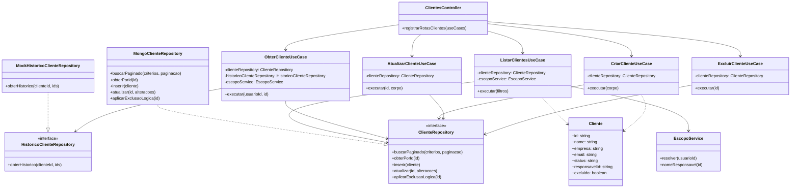

# Diagrama de classes — slice `clientes`

A slice mais completa: 5 use cases (SRP), um port (`ClienteRepository`)
implementado por um adapter real (`MongoClienteRepository`) — Dependency
Inversion visível: os use cases dependem da interface, nunca da
implementação concreta.

