# Diagrama de classes — demais slices (oportunidades, tarefas, dashboard, interações, usuários, health)

Mesma notação da slice `clientes`, com menos detalhe por slice, para fechar
a cobertura do diagrama de classes do backend inteiro.

```mermaid
classDiagram
  class OportunidadeRepository { <<interface>> +listarVisiveis(ids) +obterPorId(id) }
  class MockOportunidadeRepository { +listarVisiveis(ids) +obterPorId(id) }
  class ListarOportunidadesUseCase { +executar(filtros) }
  class CriarOportunidadeUseCase { +executar(corpo) }
  class MoverOportunidadeUseCase { +executar(id, corpo) }
  MockOportunidadeRepository ..|> OportunidadeRepository
  ListarOportunidadesUseCase --> OportunidadeRepository
  MoverOportunidadeUseCase --> OportunidadeRepository

  class TarefaRepository { <<interface>> +listarVisiveis(ids) +obterPorId(id) }
  class MockTarefaRepository { +listarVisiveis(ids) +obterPorId(id) }
  class ListarTarefasUseCase { +executar(filtros) }
  class AtualizarTarefaUseCase { +executar(id, corpo) }
  MockTarefaRepository ..|> TarefaRepository
  ListarTarefasUseCase --> TarefaRepository
  AtualizarTarefaUseCase --> TarefaRepository

  class ClienteStatusRepository { <<interface>> +listarStatusVisiveis(ids) }
  class MongoClienteStatusRepository { +listarStatusVisiveis(ids) }
  class ObterDashboardUseCase { +executar(usuarioId) }
  MongoClienteStatusRepository ..|> ClienteStatusRepository
  ObterDashboardUseCase --> ClienteStatusRepository

  class RegistrarInteracaoUseCase { +executar(clienteId, corpo) }
  class ClienteConsultaRepository { +listarTodos() +obterPorId(id) }
  RegistrarInteracaoUseCase --> ClienteConsultaRepository

  class UsuarioRepository { <<interface>> +listarTodos() }
  class InMemoryUsuarioRepository { +listarTodos() }
  class ListarUsuariosUseCase { +executar(filtros) }
  InMemoryUsuarioRepository ..|> UsuarioRepository
  ListarUsuariosUseCase --> UsuarioRepository

  class SaudeRepository { <<interface>> +obterReferenciaERegistros() +obterEstadoDoBanco() }
  class SaudeRepositoryImpl { +obterReferenciaERegistros() +obterEstadoDoBanco() }
  class ObterSaudeUseCase { +executar() }
  SaudeRepositoryImpl ..|> SaudeRepository
  ObterSaudeUseCase --> SaudeRepository
```

