# Diagrama de componentes — backend Mini CRM

Vertical Slice Architecture: cada área de rota é uma fatia que atravessa as
camadas da Clean Architecture (domain → application → adapters). O kernel
compartilhado fica na base e nunca depende de uma slice específica — a seta
de dependência sempre aponta para dentro.

```mermaid
graph TB
  subgraph Clientes["Slice: clientes (Nicolas Tancon)"]
    direction TB
    C_HTTP["adapters/http
clientes.controller.js"]
    C_APP["application
use-cases + ports"]
    C_DOM["domain
Cliente.js"]
    C_PERS["adapters/persistence
MongoClienteRepository"]
    C_HTTP --> C_APP --> C_DOM
    C_PERS -.implementa.-> C_APP
  end

  subgraph Oportunidades["Slice: oportunidades (Leandro Canha)"]
    direction TB
    O_HTTP["adapters/http"]
    O_APP["application"]
    O_DOM["domain
Oportunidade.js"]
    O_PERS["adapters/persistence
MockOportunidadeRepository"]
    O_HTTP --> O_APP --> O_DOM
    O_PERS -.implementa.-> O_APP
  end

  subgraph Tarefas["Slice: tarefas (Leandro Canha)"]
    direction TB
    T_HTTP["adapters/http"]
    T_APP["application"]
    T_DOM["domain
Tarefa.js"]
    T_PERS["adapters/persistence
MockTarefaRepository"]
    T_HTTP --> T_APP --> T_DOM
    T_PERS -.implementa.-> T_APP
  end

  subgraph Dashboard["Slice: dashboard (Pedro Costa)"]
    direction TB
    D_HTTP["adapters/http"]
    D_APP["application"]
    D_DOM["domain
Dashboard.js"]
    D_PERS["adapters/persistence"]
    D_HTTP --> D_APP --> D_DOM
    D_PERS -.implementa.-> D_APP
  end

  subgraph Interacoes["Slice: interacoes (Pedro Costa)"]
    direction TB
    I_HTTP["adapters/http"]
    I_APP["application
RegistrarInteracaoUseCase"]
    I_DOM["domain
Interacao.js"]
    I_HTTP --> I_APP --> I_DOM
  end

  subgraph UsuariosHealth["Slices: usuarios + health (Lincoln Neto)"]
    direction TB
    U_HTTP["adapters/http"]
    U_APP["application"]
    U_DOM["domain"]
    U_HTTP --> U_APP --> U_DOM
  end

  subgraph Kernel["Kernel compartilhado — shared/ (Lincoln Neto)"]
    direction LR
    K_HTTP["http.js"]
    K_MONGO["mongo.js"]
    K_DADOS["dados.js"]
    K_ESCOPO["escopo.js / EscopoService.js"]
    K_VALID["validacao.js"]
    K_CLI["ClienteConsultaRepository.js"]
  end

  C_PERS --> K_MONGO
  C_APP --> K_ESCOPO
  C_APP --> K_VALID
  O_PERS --> K_DADOS
  O_APP --> K_ESCOPO
  O_APP --> K_CLI
  O_APP --> K_VALID
  T_PERS --> K_DADOS
  T_APP --> K_ESCOPO
  T_APP --> K_CLI
  D_PERS --> K_MONGO
  D_PERS --> K_DADOS
  D_APP --> K_ESCOPO
  I_APP --> K_CLI
  I_APP --> K_VALID
  U_APP --> K_DADOS
  C_HTTP --> K_HTTP
  O_HTTP --> K_HTTP
  T_HTTP --> K_HTTP
  D_HTTP --> K_HTTP
  I_HTTP --> K_HTTP
  U_HTTP --> K_HTTP
```

